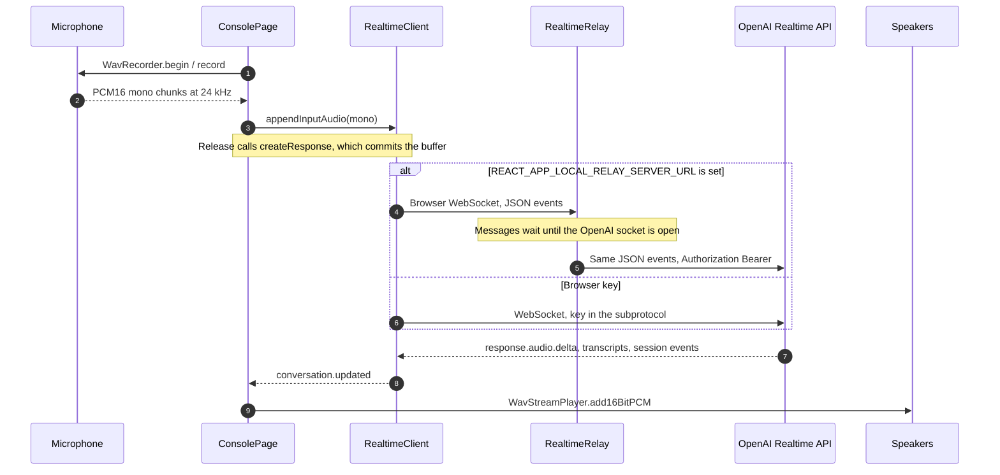

# Realtime Voice Agent

A browser voice agent for the [OpenAI Realtime API](https://platform.openai.com/docs/guides/realtime). Hold to talk, release to send, and the model answers with speech. An optional Node.js relay keeps the API key on the server.

This repository is a fork of OpenAI's [realtime console](https://github.com/openai/openai-realtime-console). The audio path and reference client are from that project. The page here is a push-to-talk session with a custom system prompt and a microphone visualizer. The weather tool, memory panel, map, and event inspector from the upstream console are not in this tree.

## Features

- Push-to-talk capture. Press and hold, speak, then release. Releasing commits the audio buffer and asks the model for a response.
- Spoken replies. Assistant audio is PCM16 at 24 kHz and is played as it arrives. A finished turn can be replayed from the transcript.
- Barge-in. Starting a new push-to-talk turn stops playback and truncates the assistant item at the sample the listener had reached.
- Live transcript. User audio is transcribed with `whisper-1`. Assistant text is the Realtime transcript.
- Greeting. Connecting sends the text `Hello!`, which makes the model speak first.
- Session instructions from [`src/utils/conversation_config.js`](src/utils/conversation_config.js). The prompt asks for a warm, patient assistant. The client does not register any tools, so lines in that prompt about opening apps or websites are instructions only.
- Two ways to authenticate: paste a key into the page, or point the page at the local relay.
- A canvas blob that deforms with the microphone frequency data while you are recording.

The reference client pinned in `package-lock.json` (`@openai/realtime-api-beta` at `2474cfe`) opens a session with voice `alloy`, modalities `text` and `audio`, and PCM16 input and output. Turn detection is `null`, so the UI is manual. The app then sets the instructions and `input_audio_transcription: { model: "whisper-1" }`. The model id that client connects with is `gpt-4o-realtime-preview-2024-10-01`.

## Architecture



`ConsolePage` owns three objects for the life of the page:

- `WavRecorder` reads the microphone through an AudioWorklet and emits mono PCM16.
- `WavStreamPlayer` plays PCM16 chunks on a second AudioWorklet.
- `RealtimeClient` from `@openai/realtime-api-beta` turns those chunks into Realtime events and turns server audio deltas back into PCM16.

In relay mode the browser client is constructed with `{ url }` and no API key. The relay constructs its own `RealtimeClient` with `OPENAI_API_KEY` and copies JSON events in both directions. It accepts only the `/` path. It does not inspect or authenticate the browser.

## Tech stack

| Piece | What it is |
| --- | --- |
| UI | React 18, TypeScript, Sass, Create React App (`react-scripts` 5) |
| Icons | `react-feather` |
| Realtime client | `@openai/realtime-api-beta` (GitHub dependency, commit pinned in the lockfile) |
| Browser audio | Vendored [`src/lib/wavtools`](src/lib/wavtools) (record, play, WAV pack, frequency data) |
| Relay | Node.js, `ws`, `dotenv`, `nodemon` |
| Model path | Realtime preview model above, `whisper-1` for input transcripts |

`leaflet`, `react-leaflet`, and a package named `save` were installed but unused after the map UI was removed. They are not dependencies anymore.

## Setup

You need Node.js and npm, a Chromium, Firefox, or Safari build with AudioWorklet and microphone permission, and an OpenAI user or project key that can call the Realtime API.

```shell
npm install
cp .env.example .env
```

Edit `.env`. Variable reference:

| Variable | Where it is read | Required | Purpose |
| --- | --- | --- | --- |
| `OPENAI_API_KEY` | Relay process only | Yes, for `npm run relay` | Sent as `Authorization: Bearer` from the relay. Never imported by the React app. |
| `PORT` | Relay process | No | WebSocket port. Default `8081` when the value is missing or not a port number. |
| `REACT_APP_LOCAL_RELAY_SERVER_URL` | Browser bundle | No | WebSocket URL of the relay, for example `ws://localhost:8081`. When set, the page does not ask for a key. |

Create React App inlines `REACT_APP_*` when `npm start` or `npm run build` starts. Restart the dev server after changing it. `dotenv` is loaded with `override: true`, so values in `.env` replace variables already set in the shell for the relay process.

The pinned browser client uses the URL as a WebSocket URL. Use `ws://`, not `http://`. The client appends `?model=gpt-4o-realtime-preview-2024-10-01`. The relay ignores that query string.

### Browser key

Leave `REACT_APP_LOCAL_RELAY_SERVER_URL` unset.

```shell
npm start
```

Open [http://localhost:3000](http://localhost:3000). The page prompts for an API key and stores it in `localStorage` under `tmp::voice_api_key`. The header button shows the first three characters and replaces the key on click. That click clears all of `localStorage`, then reloads.

Click **connect**, allow the microphone, and use **push to talk**. **disconnect** closes the socket, stops the microphone, and stops playback.

### Relay

Uncomment `REACT_APP_LOCAL_RELAY_SERVER_URL` in `.env`, set `OPENAI_API_KEY`, and restart the React dev server if it is already running.

```shell
npm run relay
```

The relay listens on `ws://localhost:8081` unless `PORT` is set. In another terminal:

```shell
npm start
```

The relay has to be running before you click **connect**. There is no key prompt in this mode.

### Static build

```shell
npm run build
```

This writes a static bundle to `build/`. The relay is still a separate process. The bundle contains whatever `REACT_APP_LOCAL_RELAY_SERVER_URL` was at build time.

## Project structure

```text
public/                 HTML shell and the OpenAI logomark
relay-server/index.js   Loads .env, checks the API key, listens
relay-server/lib/relay.js
src/App.tsx             Renders ConsolePage
src/pages/ConsolePage.tsx
src/pages/ConsolePage.scss
src/utils/conversation_config.js   System instructions
src/utils/wav_renderer.ts          Canvas blob
src/lib/wavtools/       Vendored record / playback library
src/components/button/  Button used by the console
readme/realtime-console-demo.png   Upstream console screenshot, not this UI
```

There is a Jest setup file and no test suite. `npm test` starts the Create React App runner and does not exercise the relay or the audio path.

## Security

- Do not commit `.env`. `.gitignore` ignores `.env` and `.env.*`, and keeps `.env.example`. An earlier commit removed `.env` from `.gitignore`. It is ignored again. A search of the current tree and of reachable git history found no API keys, private keys, or committed env files. If a key was written to `.env` and pushed from another clone while that ignore rule was missing, or pasted into the browser on a shared machine, revoke it in the OpenAI dashboard and create a new one. The relay used to print the first three characters of the key to stdout. That log line is gone. Rotate a key if those logs were shipped somewhere you do not control.
- Browser mode uses `dangerouslyAllowAPIKeyInBrowser`. The key sits in `localStorage` and is sent on the WebSocket subprotocol. Use that mode only on your own machine.
- The relay is the path that keeps the key out of the page. It still has no caller authentication, and `ws` listens on all interfaces by default. Do not publish port `8081`. Anyone who can open that socket can spend the key.
- The system prompt is in the client bundle. Anyone who loads the page can read it.
- The relay forwards client events unchanged. It does not filter event types.

## Roadmap

- Register real tools, or edit the system prompt so it does not describe actions this app cannot take.
- Put the instructions and any tool handlers on the relay, and reject client events that try to replace them.
- Require a shared secret on the relay and bind it to localhost unless a host is set on purpose.
- Add a control for `server_vad`. The client supports it. This page does not switch it on.
- Drive the canvas from assistant playback as well as the microphone.
- Pin a current Realtime model and client instead of `gpt-4o-realtime-preview-2024-10-01`.
- Add tests for relay queueing, pathname checks, and the push-to-talk commit / cancel sequence.

## License

[MIT](LICENSE). Copyright 2024 OpenAI and copyright 2024 Sydney Ani. The Realtime console, reference client, and wavtools originated at OpenAI. Changes in this fork are by Sydney Ani.
